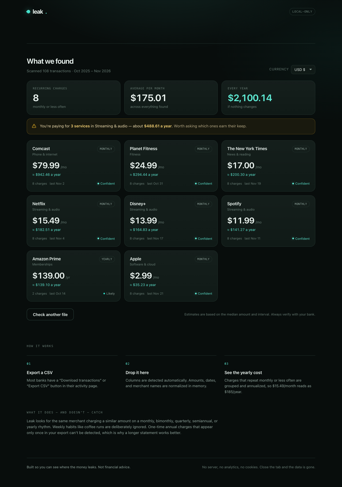

# leak.

Find the subscriptions quietly draining your account.

**Live:** https://santiagorandolph.github.io/leak/

Drop in a bank CSV and Leak groups charges that repeat monthly or less often,
then adds up what each one costs per year. Everything runs in the browser:
no upload, no account, no analytics, no storage.



## Run it

Open `index.html` in a browser. That's it — there is no build step and no
dependencies. Click **Try sample data** to see it work immediately.

If you prefer a local server:

```sh
python3 -m http.server 8080
# then open http://localhost:8080
```

## What it accepts

- A CSV or plain-text transaction export with a date, a description, and an
  amount (or debit) column.
- Comma, semicolon, tab, or pipe delimiters.
- Quoted fields, `$`/`€`/`£` symbols, thousands separators, accounting
  negatives like `(12.00)`, and European decimals like `1.234,56`.
- Header or headerless files, plus English/German/Spanish/French column names.
- Negative debits or separate positive debit columns.

Dates support ISO (`2025-03-09`), `09/03/2025`, `25/03/2025`,
`05 Jan 2025`, and `Jan 5, 2025`. Ambiguous numeric dates are read
month-first (US).

## How detection works

1. Normalize merchant names (strip card numbers, store IDs, `POS DEBIT`,
   `AUTOPAY`, and similar noise).
2. Group transactions by merchant.
3. Keep groups whose median gap between charges fits a monthly (25–35 days),
   bimonthly (55–72), quarterly (80–100), semiannual (170–200), or yearly
   (350–380) rhythm. Weekly habits are deliberately ignored.
4. Require stable amounts (within about 18%) and a consistent rhythm.
5. Estimate the yearly cost from the median amount and interval.

Each result gets a confidence score based on how many charges were seen, how
consistent the amount is, and how regular the timing is. Results are sorted by
yearly cost. Services in the same category (streaming, software, fitness,
news, gaming) are flagged when you pay for more than one.

## Limits

- One annual charge that appears only once in the export cannot be detected.
  Three to twelve months of transactions works best.
- Weekly and daily habits are excluded on purpose. This is about charges that
  renew on their own, not every repeated purchase.
- Sign conventions vary by bank. Leak prefers negative amounts as spending
  when both signs exist, and ignores paycheck/deposit-like descriptions.
- Merchant normalization is heuristic. Two different services with very
  similar names could be merged.
- Currency conversion is not performed. The display currency is formatting
  only; amounts are shown as they appear in your export.

Not financial advice. Always verify against your bank.

## Files

```
index.html      page structure and copy
styles.css      all styling, no external fonts
detector.js     CSV parsing, normalization, recurrence detection (pure)
sample-data.js  generates a realistic demo export relative to today
app.js          file handling, rendering, interactions
test.js         Node test suite for the detector
favicon.svg     the little teal drop
```

## Tests

```sh
node test.js
```

16 tests cover value parsing, delimited/headerless formats, yearly and
monthly detection, income/one-off filtering, duplicate warnings, and totals.
Requires Node 18+.

## Privacy

Files are read with the browser's `FileReader`/`File.text()` and parsed in
memory. There are no `fetch` calls, no third-party assets, and no persistence.
Close the tab and the data is gone.
